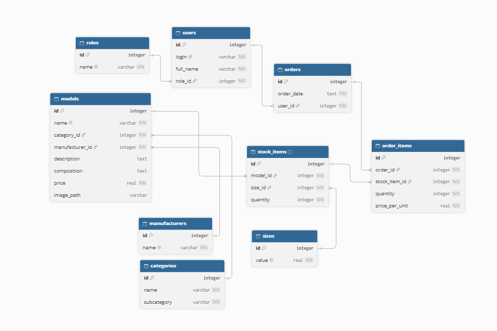

# Универсальный шаблон проекта «Информационная система магазина»

Репозиторий для отработки демо-экзамена и учебной практики. 

## Стек

- **Python 3.12+**
- **Streamlit** — веб-интерфейс
- **SQLite** — база данных

## ER-диаграмма



---

## Быстрый запуск (Windows)
Открой консоль и перейди в папку проекта и активируй файл с расширением bat. 

```bash .\run_project.bat```

Что делает `run_project.bat`:
- активирует виртуальное окружение (создает, если его нет);
- устанавливает зависимости из `requirements.txt`;
- создает базу данных (`init_db.py`) и импортирует данные из Excel (`import_data.py`);
- запускает приложение.

Перейди по `http://localhost:8501`


## Ручной запуск (любая ОС)

```bash
python -m venv .venv
# Windows: .venv\Scripts\activate
# Linux/macOS: source .venv/bin/activate

pip install -r requirements.txt

cd scr
python init_db.py
python import_data.py
streamlit run app.py